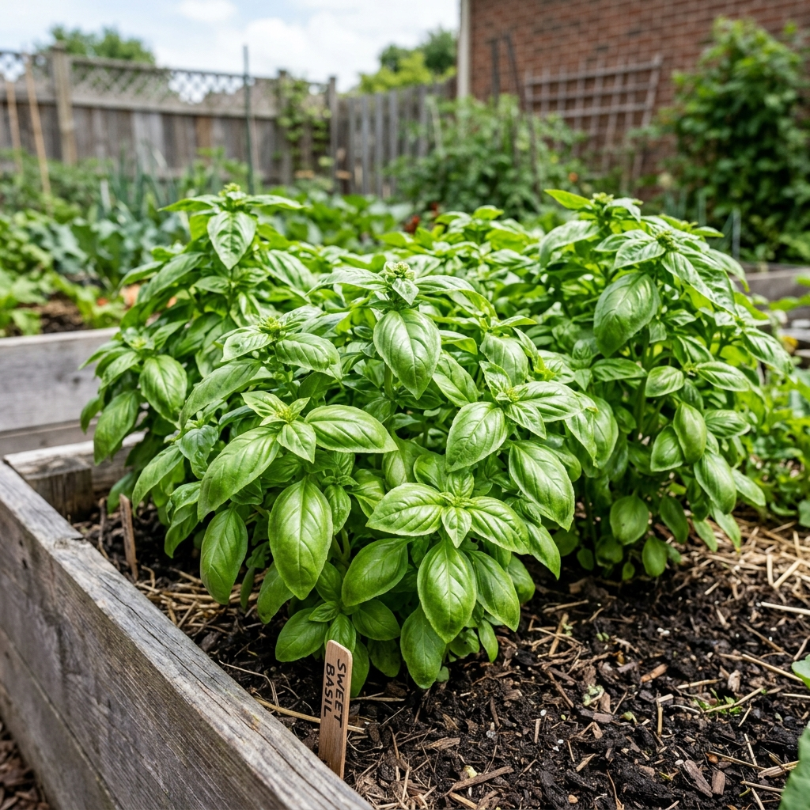

# Albahaca morada

### 📋 Ficha Técnica de Cultivo

* 🌿 **Familia Botánica:** Lamiaceae
* 🕒 **Tiempo hasta la cosecha:** ~60 días
* 📦 **Stock disponible:** 20 semillas / unidades
* 📅 **Meses de siembra:** Agosto, Septiembre, Octubre, Noviembre
* ⚠️ **Método de siembra / Desplante:** Almácigo

---

### 📝 Observaciones y Tips
> Aromática y muy decorativa. Sensible al frío.

[⬅ Volver al listado en HuertAlerta](https://github.com/dilelu94/HuertAlerta)
