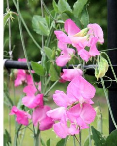

# Arvejilla (Flor)

### 📋 Ficha Técnica de Cultivo

* 🌿 **Familia Botánica:** Fabaceae
* 🕒 **Tiempo hasta la cosecha:** ~100 días
* 📦 **Stock disponible:** 40 semillas / unidades
* 📅 **Meses de siembra:** Marzo, Abril, Mayo, Junio
* ⚠️ **Método de siembra / Desplante:** Al florecer

---

### 📝 Observaciones y Tips
> Trepadora de invierno muy perfumada y decorativa.

[⬅ Volver al listado en HuertAlerta](https://github.com/dilelu94/HuertAlerta)
