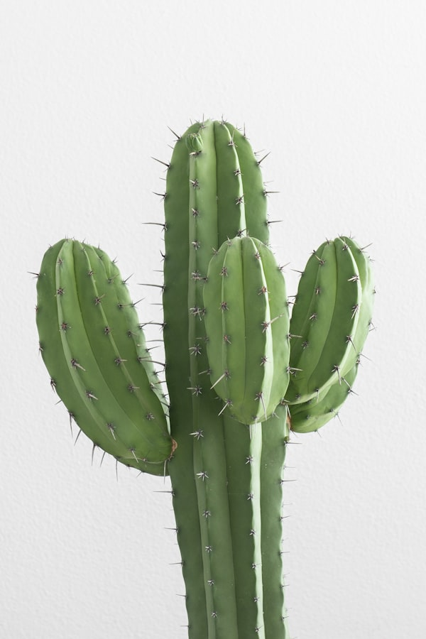

# Caléndula

### 📋 Ficha Técnica de Cultivo

* 🌿 **Familia Botánica:** Asteraceae
* 🕒 **Tiempo hasta la cosecha:** ~60 días
* 📦 **Stock disponible:** 1 semillas / unidades
* 📅 **Meses de siembra:** Marzo, Abril, Mayo, Agosto, Septiembre, Octubre
* ⚠️ **Método de siembra / Desplante:** Directa o almácigo

---

### 📝 Observaciones y Tips
> Flor comestible y medicinal. Atrae polinizadores y repele pulgones.

[⬅ Volver al listado en HuertAlerta](https://github.com/dilelu94/HuertAlerta)
