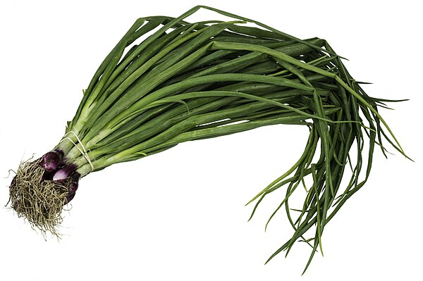

# Cebolla de Verdeo

### 📋 Ficha Técnica de Cultivo

* 🌿 **Familia Botánica:** Amaryllidaceae
* 🕒 **Tiempo hasta la cosecha:** ~90 días
* 📦 **Stock disponible:** 40 semillas / unidades
* 📅 **Meses de siembra:** Febrero, Marzo, Abril, Mayo, Junio, Julio, Agosto, Septiembre, Octubre
* ⚠️ **Método de siembra / Desplante:** Continuo o desplante

---

### 📝 Observaciones y Tips
> Se puede usar el bulbo y la hoja.

[⬅ Volver al listado en HuertAlerta](https://github.com/dilelu94/HuertAlerta)
