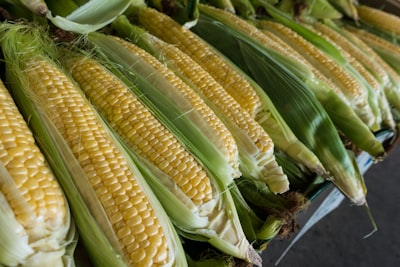

# Chaucha

### 📋 Ficha Técnica de Cultivo

* 🌿 **Familia Botánica:** Fabaceae
* 🕒 **Tiempo hasta la cosecha:** ~70 días
* 📦 **Stock disponible:** 12 semillas / unidades
* 📅 **Meses de siembra:** Octubre, Noviembre, Diciembre, Enero
* ⚠️ **Método de siembra / Desplante:** Desplante por cosecha

---

### 📝 Observaciones y Tips
> Siembra directa cuando ya no hay riesgo de heladas.

[⬅ Volver al listado en HuertAlerta](https://github.com/dilelu94/HuertAlerta)
