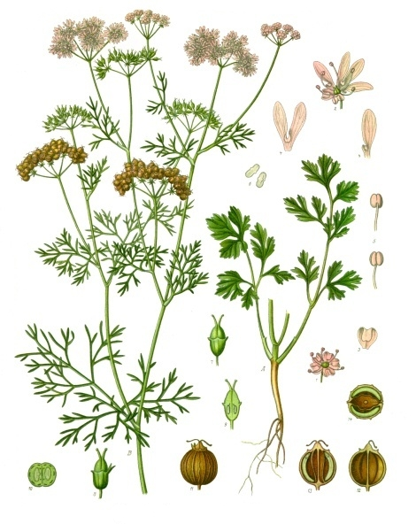

# Cilantro

### 📋 Ficha Técnica de Cultivo

* 🌿 **Familia Botánica:** Apiaceae
* 🕒 **Tiempo hasta la cosecha:** ~40 días
* 📦 **Stock disponible:** 20 semillas / unidades
* 📅 **Meses de siembra:** Agosto, Septiembre, Octubre, Marzo, Abril, Mayo
* ⚠️ **Método de siembra / Desplante:** Directa

---

### 📝 Observaciones y Tips
> Tiende a espigar rápido con calor. Sembrar escalonado.

[⬅ Volver al listado en HuertAlerta](https://github.com/dilelu94/HuertAlerta)
