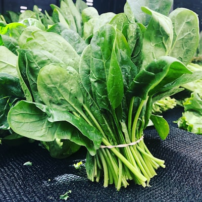

# Espinaca Frutilla (Blitum capitatum)

### 📋 Ficha Técnica de Cultivo

* 🌿 **Familia Botánica:** Amaranthaceae
* 🕒 **Tiempo hasta la cosecha:** ~65 días
* 📦 **Stock disponible:** 11 semillas / unidades
* 📅 **Meses de siembra:** Marzo, Abril, Mayo, Agosto, Septiembre
* ⚠️ **Método de siembra / Desplante:** Siembra directa superficial (semilla muy fina) o almácigo

---

### 📝 Observaciones y Tips
> Se aprovechan hojas (como espinaca) y pequeños frutos rojos. Requiere clima fresco, se espiga con el calor intenso del verano.

[⬅ Volver al listado en HuertAlerta](https://github.com/dilelu94/HuertAlerta)
