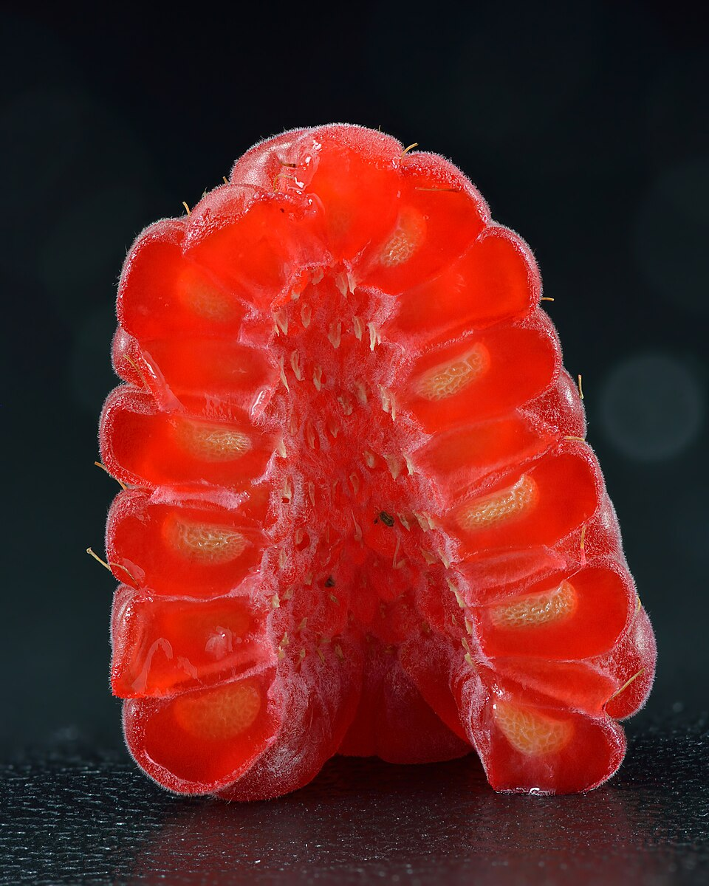

# Frutos (Frutilla / Arándano / Frambuesa / Uva)

### 📋 Ficha Técnica de Cultivo

* 🌿 **Familia Botánica:** Rosaceae/Ericaceae/Vitaceae
* 🕒 **Tiempo hasta la cosecha:** ~365 días
* 📦 **Stock disponible:** 200 semillas / unidades
* 📅 **Meses de siembra:** Mayo, Junio, Julio
* ⚠️ **Método de siembra / Desplante:** Perenne

---

### 📝 Observaciones y Tips
> Plantas perennes (stock de seguridad 50 c/u).

[⬅ Volver al listado en HuertAlerta](https://github.com/dilelu94/HuertAlerta)
