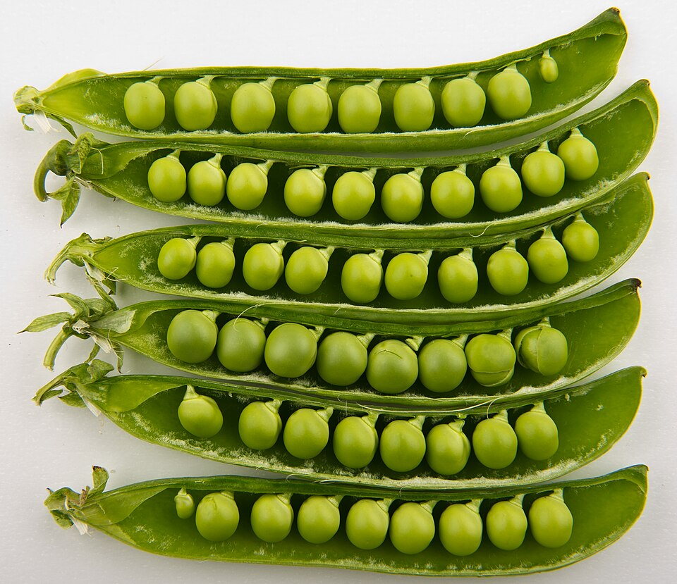

# Habas

### 📋 Ficha Técnica de Cultivo

* 🌿 **Familia Botánica:** Fabaceae (Leguminosas)
* 🕒 **Tiempo hasta la cosecha:** ~105 días
* 📦 **Stock disponible:** 12 semillas / unidades
* 📅 **Meses de siembra:** Marzo, Abril, Mayo, Junio, Julio, Agosto
* ⚠️ **Método de siembra / Desplante:** Siembra directa (a 3-5 cm de profundidad)

---

### 📝 Observaciones y Tips
> Tolera muy bien el frío y aporta nitrógeno a la tierra. Dejar 15-20 cm de separación entre plantas.

[⬅ Volver al listado en HuertAlerta](https://github.com/dilelu94/HuertAlerta)
