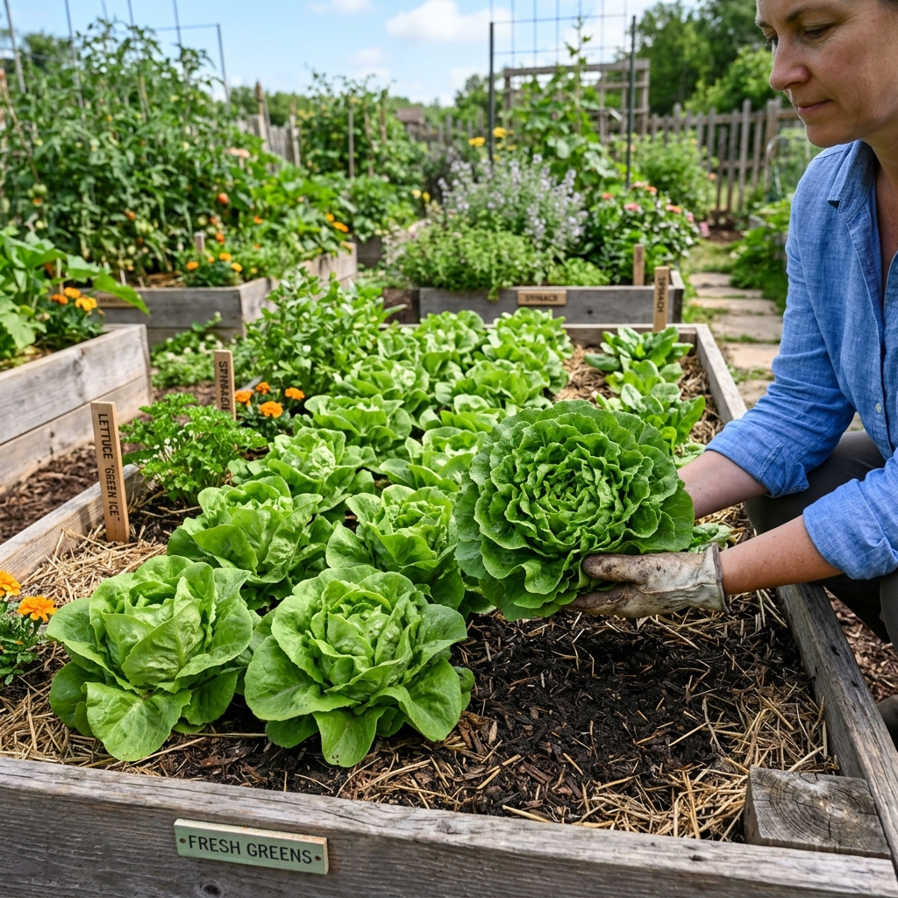

# Lechuga mantecosa

### 📋 Ficha Técnica de Cultivo

* 🌿 **Familia Botánica:** Asteraceae
* 🕒 **Tiempo hasta la cosecha:** ~60 días
* 📦 **Stock disponible:** 80 semillas / unidades
* 📅 **Meses de siembra:** Febrero, Marzo, Abril, Mayo, Agosto, Septiembre, Octubre
* ⚠️ **Método de siembra / Desplante:** Almácigo o directa

---

### 📝 Observaciones y Tips
> Hojas suaves y mantecosas que forman cogollo tierno. Requiere riego constante y suelo fresco; cosechar temprano por la mañana para conservar máxima turgencia.

[⬅ Volver al listado en HuertAlerta](https://github.com/dilelu94/HuertAlerta)
