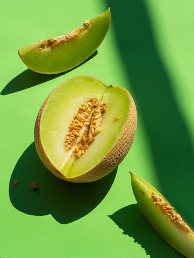

# Melón

### 📋 Ficha Técnica de Cultivo

* 🌿 **Familia Botánica:** Cucurbitaceae
* 🕒 **Tiempo hasta la cosecha:** ~100 días
* 📦 **Stock disponible:** 15 semillas / unidades
* 📅 **Meses de siembra:** Septiembre, Octubre, Noviembre, Diciembre
* ⚠️ **Método de siembra / Desplante:** Directa (a golpes)

---

### 📝 Observaciones y Tips
> Actualizado desde lista OCR.

[⬅ Volver al listado en HuertAlerta](https://github.com/dilelu94/HuertAlerta)
