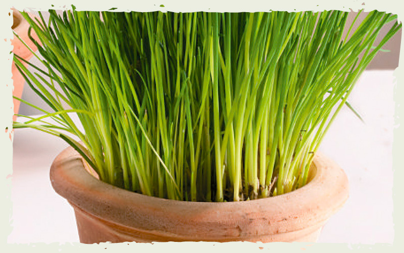

# Mostaza

### 📋 Ficha Técnica de Cultivo

* 🌿 **Familia Botánica:** Brassicaceae
* 🕒 **Tiempo hasta la cosecha:** ~40 días
* 📦 **Stock disponible:** 50 semillas / unidades
* 📅 **Meses de siembra:** Marzo, Abril, Mayo, Agosto, Septiembre
* ⚠️ **Método de siembra / Desplante:** Directa

---

### 📝 Observaciones y Tips
> Hojas picantes para ensalada y semillas para condimento.

[⬅ Volver al listado en HuertAlerta](https://github.com/dilelu94/HuertAlerta)
