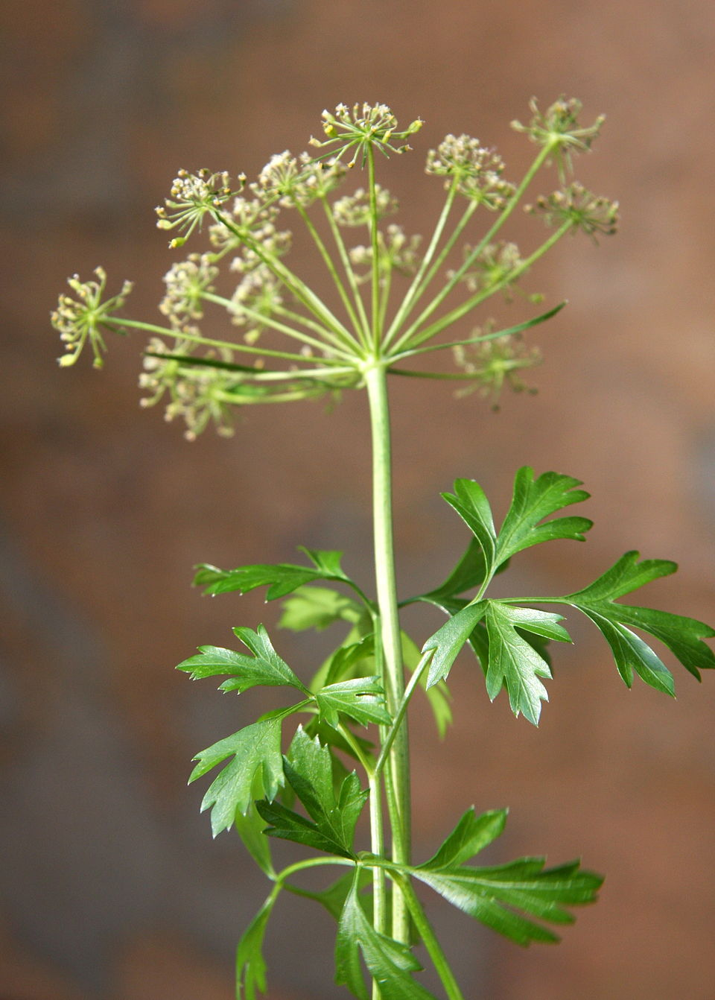

# Perejil liso

### 📋 Ficha Técnica de Cultivo

* 🌿 **Familia Botánica:** Apiaceae
* 🕒 **Tiempo hasta la cosecha:** ~70 días
* 📦 **Stock disponible:** 30 semillas / unidades
* 📅 **Meses de siembra:** Agosto, Septiembre, Octubre, Febrero, Marzo, Abril
* ⚠️ **Método de siembra / Desplante:** Directa (remojar semillas 24h)

---

### 📝 Observaciones y Tips
> Cosecha continua de hojas externas.

[⬅ Volver al listado en HuertAlerta](https://github.com/dilelu94/HuertAlerta)
