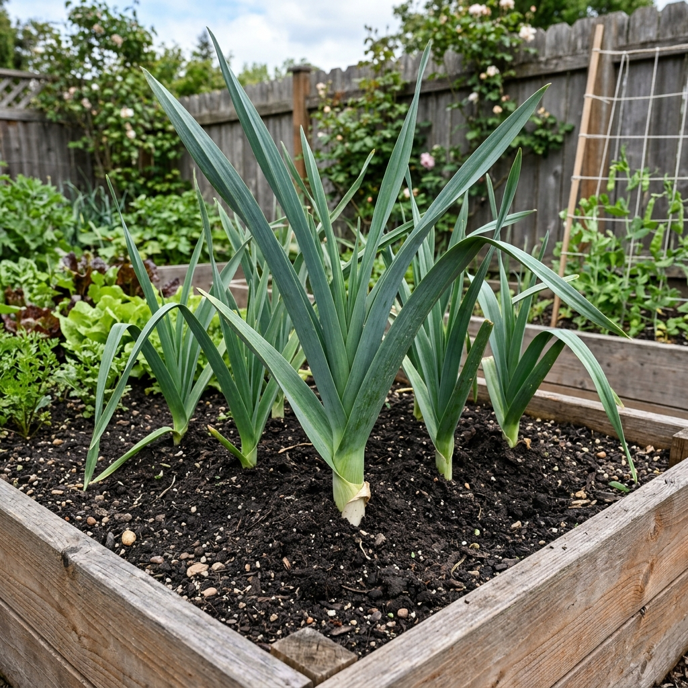

# Puerro

### 📋 Ficha Técnica de Cultivo

* 🌿 **Familia Botánica:** Amaryllidaceae
* 🕒 **Tiempo hasta la cosecha:** ~120 días
* 📦 **Stock disponible:** 30 semillas / unidades
* 📅 **Meses de siembra:** Febrero, Marzo, Abril, Mayo, Agosto, Septiembre, Octubre
* ⚠️ **Método de siembra / Desplante:** Desplante por cosecha

---

### 📝 Observaciones y Tips
> Aporcar (cubrir con tierra) la base para blanquear el tallo.

[⬅ Volver al listado en HuertAlerta](https://github.com/dilelu94/HuertAlerta)
