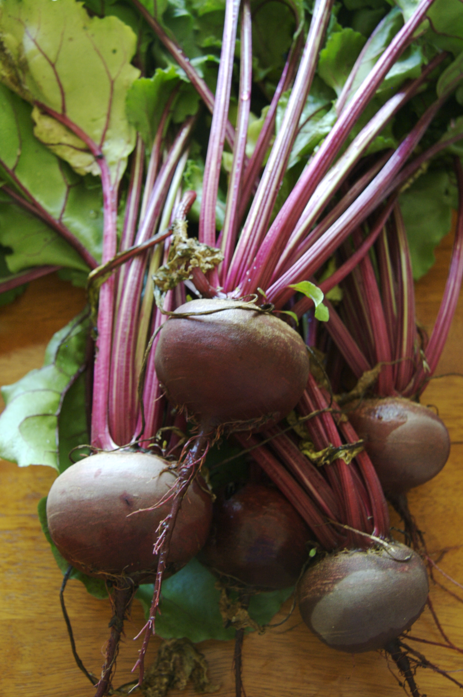

# Remolacha

### 📋 Ficha Técnica de Cultivo

* 🌿 **Familia Botánica:** Amaranthaceae
* 🕒 **Tiempo hasta la cosecha:** ~90 días
* 📦 **Stock disponible:** 20 semillas / unidades
* 📅 **Meses de siembra:** Enero, Febrero, Marzo, Abril, Mayo, Junio, Julio, Agosto, Septiembre, Octubre, Noviembre, Diciembre
* ⚠️ **Método de siembra / Desplante:** Desplante por cosecha

---

### 📝 Observaciones y Tips
> Las hojas jóvenes también son comestibles en ensalada.

[⬅ Volver al listado en HuertAlerta](https://github.com/dilelu94/HuertAlerta)
