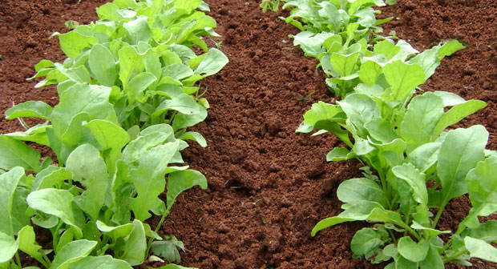

# Rúcula

### 📋 Ficha Técnica de Cultivo

* 🌿 **Familia Botánica:** Brassicaceae
* 🕒 **Tiempo hasta la cosecha:** ~40 días
* 📦 **Stock disponible:** 2000 semillas / unidades
* 📅 **Meses de siembra:** Febrero, Marzo, Abril, Mayo, Junio, Julio, Agosto, Septiembre, Octubre
* ⚠️ **Método de siembra / Desplante:** Continuo o al florecer

---

### 📝 Observaciones y Tips
> Gran cantidad disponible; ideal para siembras densas.

[⬅ Volver al listado en HuertAlerta](https://github.com/dilelu94/HuertAlerta)
