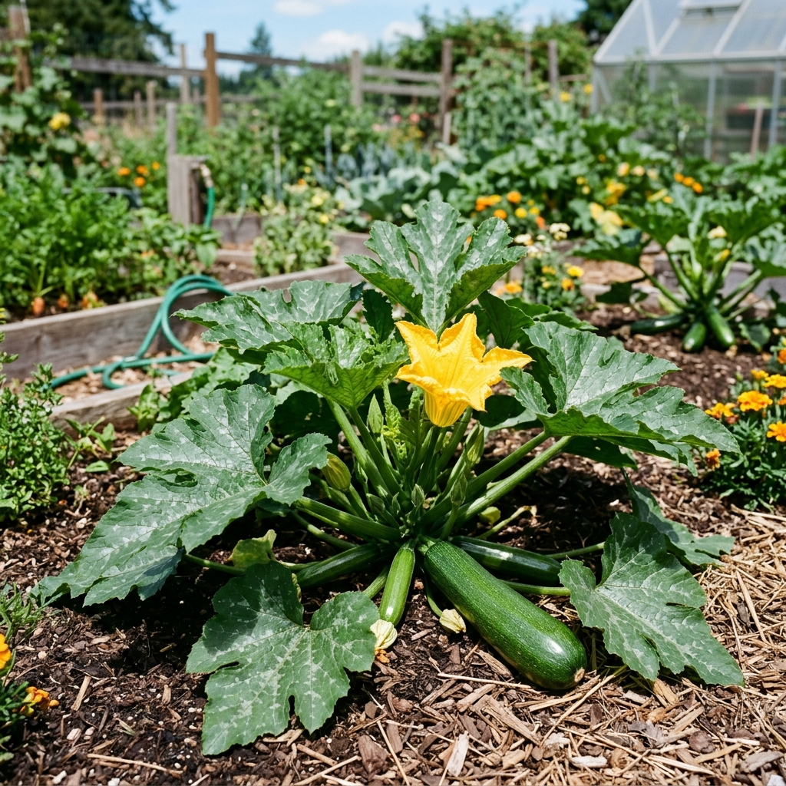

# Zapallos (Anco / Plomo / Zucchini / Mix)

### 📋 Ficha Técnica de Cultivo

* 🌿 **Familia Botánica:** Cucurbitaceae
* 🕒 **Tiempo hasta la cosecha:** ~100 días
* 📦 **Stock disponible:** 13 semillas / unidades
* 📅 **Meses de siembra:** Octubre, Noviembre, Diciembre, Enero
* ⚠️ **Método de siembra / Desplante:** Desplante por temporada

---

### 📝 Observaciones y Tips
> Incluye mix de zapallos (30 semillas extra).

[⬅ Volver al listado en HuertAlerta](https://github.com/dilelu94/HuertAlerta)
